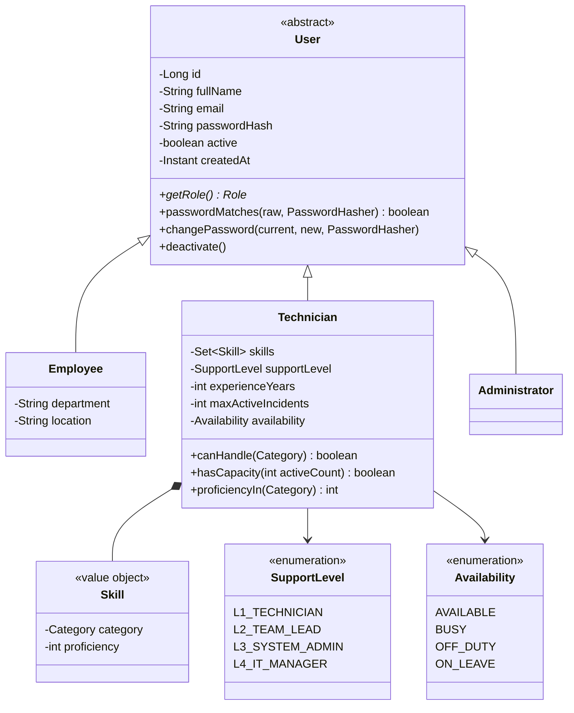
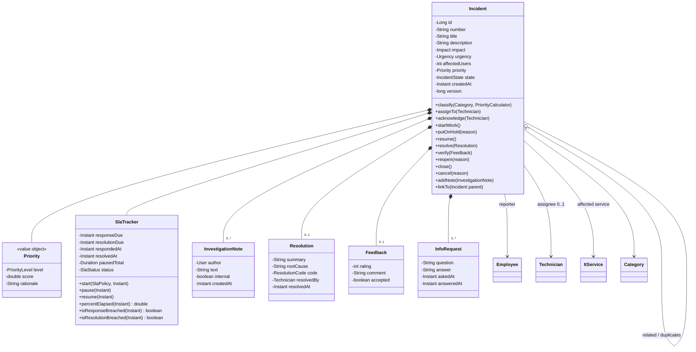
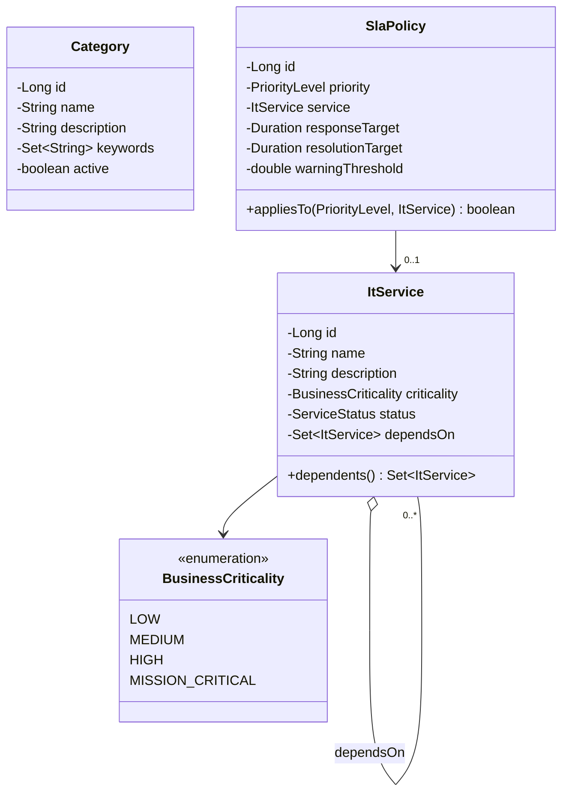
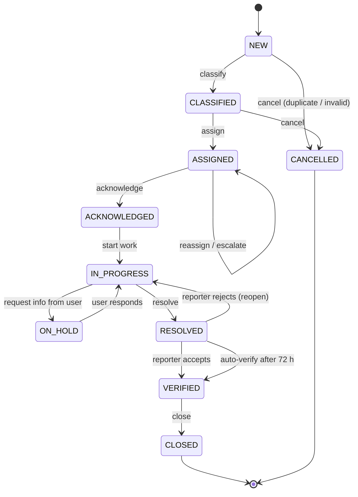
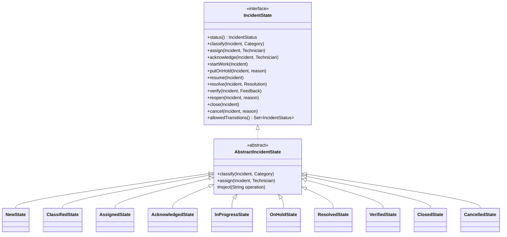
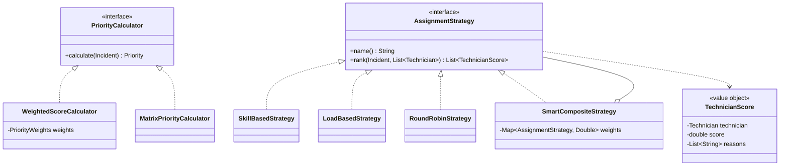
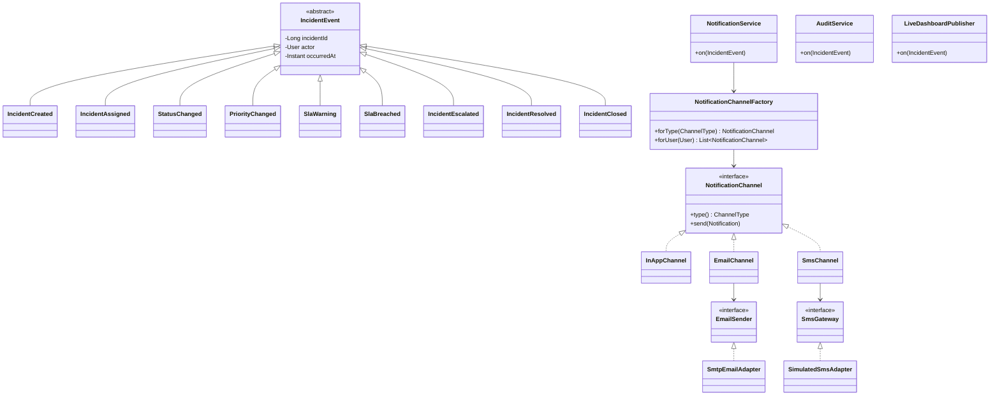
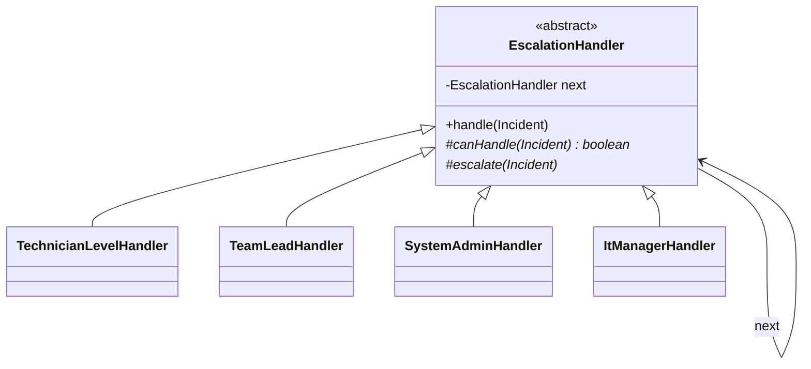
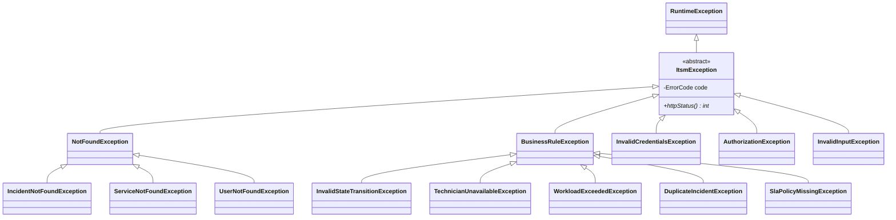

# I-ITSM — Domain Model

This document defines the core object model of I-ITSM: classes, relationships, design patterns and the
reasoning behind each decision. It is the basis for the class diagram in the report and for the backend code
(`com.iitsm.backend`).

Every feature is tagged:

| Tag | Meaning |
|---|---|
| **[MVP]** | Explicitly required by the spec. Must be done. |
| **[PLUS]** | Goes beyond the spec. Planned and in scope. |
| **[STRETCH]** | Only if time allows after everything else works. |

---

## 1. Design principles

The model is built on **SOLID**, and each principle can be pointed to in the code:

| Principle | Where it shows |
|---|---|
| **S**ingle responsibility | `Incident` holds incident data and rules; `SlaMonitor` only watches deadlines; `AuditService` only records history |
| **O**pen/closed | New notification channels, assignment strategies, categories and intelligent detectors are added **without modifying existing classes** |
| **L**iskov substitution | Any `AssignmentStrategy` or `NotificationChannel` can replace another; callers never check the concrete type |
| **I**nterface segregation | Small, focused interfaces (`PriorityCalculator`, `CategorySuggester`, `DuplicateDetector`) instead of one large "IntelligenceService" |
| **D**ependency inversion | Services depend on interfaces; Spring injects the concrete implementation |

**Rich domain model.** Business rules live **inside** the domain objects (for example `incident.acknowledge(technician)`
checks the state and records the response time). Services coordinate; they do not hold rules. This is the opposite of
an "anaemic" model where entities are only getters and setters, and it is what makes the OOP visible.

---

## 2. Users and roles



**Decisions**

- **`User` is abstract.** There is no "plain user"; every user is an Employee, a Technician or an Administrator.
  `getRole()` is abstract, so each subclass declares its role polymorphically. **[MVP]**
- **Inheritance is used only where "is-a" holds.** A Technician *is a* User. Team Lead, System Admin and IT Manager
  are **not** further subclasses: they are technicians at a higher `SupportLevel`. A deeper hierarchy would force a
  promotion to change an object's class, which is a classic misuse of inheritance. **[MVP]**
- **`Skill` is a value object with a proficiency level (1–5)**, not just a list of category names. This lets
  assignment prefer the *best* match rather than *any* match. **[PLUS]**
- **Encapsulation.** `passwordHash` has **no getter at all**: callers ask `passwordMatches()` instead. Skills are
  exposed as an unmodifiable list; `hasCapacity()` keeps the workload rule inside `Technician`. **[MVP]**
- **Dependency inversion.** `User` hashes passwords through a `PasswordHasher` interface defined in the domain; the
  security layer supplies BCrypt. The domain never depends on Spring Security, and tests use a simple fake. **[PLUS]**

---

## 3. Incident: the core aggregate



**Decisions**

- **Composition (◆)** for `SlaTracker`, notes, info requests, resolution and feedback: they cannot exist without their
  incident and are deleted with it. **[MVP]**
- **Association (→)** to reporter, assignee, service and category: those exist independently and outlive the
  incident. **[MVP]**
- **Aggregation (◇)** for related incidents: duplicates are linked to a parent incident, but each still exists on its
  own. **[PLUS]**
- **`Priority` is an immutable value object** carrying the *score* and a human-readable *rationale*
  ("Impact HIGH × Urgency HIGH × Criticality 3 = 27 → P1"). The UI shows *why* an incident got its priority.
  **[PLUS]**
- **`InfoRequest`** models "technician requests info → employee responds" as an object rather than free text, so
  the SLA clock can pause while waiting for the employee. **[PLUS]**
- **Optimistic locking (`version`)**: if two technicians edit the same incident at once, the second save is rejected
  instead of silently overwriting the first. **[PLUS]**
- **Human-readable numbers** (`INC-2026-000142`) alongside the database ID. **[PLUS]**

---

## 4. Supporting entities



- **`Category` is a database entity, not an `enum`**, so an administrator can add categories at runtime with no code
  change, as the spec requires. Its `keywords` drive automatic categorization. **[MVP]**
- **`SlaPolicy` can be service-specific.** A P1 on the *Payment* service can have a tighter SLA than a P1 elsewhere;
  if no service-specific policy exists, the generic policy for the priority applies; if neither exists,
  `SlaPolicyMissingException`. **[MVP + PLUS]**
- **Service dependency graph.** `ItService.dependsOn` records that *Payment* depends on *Database* and
  *Authentication*. Correlation uses this graph: three Payment incidents plus one Database incident point to the
  Database as a likely root cause. This is on the spec's Innovation list. **[PLUS]**

---

## 5. Incident lifecycle: State pattern





- **`AbstractIncidentState` rejects every operation by default**, throwing `InvalidStateTransitionException`.
  Each concrete state **overrides only what it allows**. NEW → CLOSED is therefore impossible by construction, not by
  an `if` that someone could forget. **[MVP]**
- **`allowedTransitions()`** is exposed through the API, so the frontend shows only the buttons that are valid right
  now. One rule, used in both places. **[PLUS]**
- **Persistence:** the database stores the status as text; a small `IncidentStateFactory` maps it back to the state
  object when an incident is loaded.
- **Beyond the spec's lifecycle:** `ON_HOLD` (pauses the SLA clock while waiting for the user), **reopen** when the
  reporter rejects a resolution, **auto-verify** after 72 hours of no response, and `CANCELLED` for duplicates.
  These mirror how real ITSM tools (ServiceNow, Jira Service Management) behave. **[PLUS]**

---

## 6. Priority and assignment: Strategy pattern



### Priority algorithm **[MVP + PLUS]**

```
score = Impact (1–4) × Urgency (1–4) × Criticality (1–4) × userFactor
userFactor = 1.0 (≤ 10 users), 1.25 (≤ 100), 1.5 (> 100)

score ≥ 36 → P1 Critical   |   ≥ 18 → P2 High   |   ≥ 8 → P3 Medium   |   else P4 Low
```

- Two interchangeable calculators: **weighted score** (above, the default) and the classic **ITIL
  Impact × Urgency matrix**. The admin chooses which one is active. **[PLUS]**
- Thresholds and weights are configuration, not hard-coded constants. **[PLUS]**
- The rationale string is stored with the result for transparency, and the algorithm is documented in the report
  as the spec requires.

### Assignment **[MVP: 2 strategies; we build 4]**

| Strategy | Picks |
|---|---|
| `SkillBasedStrategy` | Highest proficiency in the incident's category |
| `LoadBasedStrategy` | Fewest active incidents relative to capacity |
| `RoundRobinStrategy` | Next available technician in rotation (fairness) |
| `SmartCompositeStrategy` | **Weighted combination** of skill, load, experience with this service and priority: a *strategy made of strategies* (the Composite pattern) |

- Strategies **rank** rather than just pick, returning `TechnicianScore`s **with reasons** ("Skill 5/5 in Database,
  2 of 6 slots used, resolved 14 Payment incidents"). The UI shows the top 3 recommendations and the reasoning
  behind them. This is the spec's "Smart Technician Recommendation". **[PLUS]**
- Only available technicians with spare capacity are candidates; if none qualify,
  `TechnicianUnavailableException` and automatic escalation. **[MVP]**
- The admin switches the active strategy at runtime through the UI. **[MVP]**

---

## 7. Events, notifications and audit: Observer, Factory, Adapter



- **Observer:** domain operations publish an `IncidentEvent`. **Three independent listeners** react: notifications,
  audit and the live dashboard (WebSocket). The incident code knows none of them. **[MVP]**
- **Factory:** `NotificationChannelFactory` returns the right channels for a user, respecting their
  preferences. **[MVP]**
- **Adapter:** `SmtpEmailAdapter` wraps Spring's `JavaMailSender`; `SimulatedSmsAdapter` logs messages and stores
  them for display. A real SMS provider can be added later as one more adapter. **[MVP]**
- **Three channels** (in-app, email, SMS) where the spec asks for two. Email is real (SMTP). **[PLUS]**
- **User notification preferences** (for example "email only for P1/P2"). **[PLUS]**

### Audit **[MVP]**

`AuditEntry` (timestamp, actor, action, incident, previous state, new state, description) is written by the audit
listener for *every* event, so the history is complete without each feature remembering to log. Audit entries are
**append-only**: there is no update or delete in the API. **[PLUS]**

---

## 8. SLA monitoring and escalation: Chain of Responsibility

- **`SlaMonitor`** runs every minute (`@Scheduled`) over open incidents **[MVP]**:
  - at the warning threshold (default 75 % of the time elapsed), publishes `SlaWarning`
  - past a deadline, marks it breached, records the violation and publishes `SlaBreached`
- **The SLA clock pauses while ON_HOLD.** Waiting for the user does not count against the technician, as in real
  ITSM tools. **[PLUS]**
- **Escalation chain** for unacknowledged critical incidents **[PLUS]**:



  Each handler either deals with the incident or passes it up: Technician → Team Lead → System Admin → IT Manager.
  Adding a level means adding one handler.

---

## 9. Intelligent features

The spec requires two. We build **five**, each behind a small interface so implementations can be swapped (for
example rule-based ↔ AI-assisted).

| # | Feature | Interface | Approach | Tag |
|---|---|---|---|---|
| 1 | **Auto-categorization** | `CategorySuggester` | Keyword scoring against `Category.keywords` + TF-IDF over historical incidents; returns the top 3 suggestions with confidence | MVP |
| 2 | **Duplicate detection** | `DuplicateDetector` | Text similarity (TF-IDF cosine) + same service + time window (e.g. 2 h); warns the reporter *before* submitting | MVP |
| 3 | **Incident correlation** | `CorrelationEngine` | Groups open incidents by service and the **dependency graph**; flags a likely common root cause | PLUS |
| 4 | **SLA risk prediction** | `SlaRiskEstimator` | Risk score from % time elapsed, technician workload and historical average resolution time for that category | PLUS |
| 5 | **Suggested resolution** | `ResolutionAdvisor` | Finds the most similar *resolved* incidents and shows their resolutions as a lightweight knowledge base | PLUS |
| 6 | **AI-assisted categorization** | `CategorySuggester` (second implementation) | LLM API via an adapter, falling back to the rule-based suggester if unavailable | STRETCH |

The text-similarity engine (tokenize → remove stop words → TF-IDF → cosine similarity) is written **once** and shared
by features 1, 2 and 5. That reuse is itself a design point. It needs no external ML library and is fully
explainable in the demo.

---

## 10. Search: Specification pattern

The spec asks for at least 5 filters; we support **9**: number, date range, status, priority, category, service,
technician, SLA status and full-text in title or description. **[MVP + PLUS]**

Each filter is a small **`Specification<Incident>`** object; the search combines only the filters the user filled in:

```java
Specification<Incident> spec = Specification
    .where(hasStatus(status))
    .and(hasPriority(priority))
    .and(createdBetween(from, to))
    .and(textContains(query));
```

Adding a filter means adding one specification; the search code doesn't change. This works with Spring Data JPA's
built-in support. **[PLUS]**

---

## 11. Exceptions



`InvalidInputException` is deliberately not called `ValidationException`, to avoid clashing with
`jakarta.validation.ValidationException`. `InvalidCredentialsException` (401, not logged in) is kept separate from
`AuthorizationException` (403, logged in but not allowed).

- **A hierarchy, not a flat list.** Callers can catch a whole family (`NotFoundException`) or one specific
  case. **[PLUS]**
- **One `GlobalExceptionHandler`** (`@RestControllerAdvice`) turns every exception into a consistent JSON error
  `{code, message, timestamp, path}`, and each exception declares its own HTTP status polymorphically. **[MVP]**
- Database and network failures (Spring's `DataAccessException`, mail failures) are caught at the boundary,
  logged, and returned as a clean `503`. A failed email never breaks the incident operation that triggered it. **[MVP]**

---

## 12. Design patterns summary

The spec requires two. We use **ten**, each solving a real problem in this system:

| # | Pattern | Where | Problem it solves |
|---|---|---|---|
| 1 | **State** | Incident lifecycle | Enforces valid transitions by construction |
| 2 | **Strategy** | Priority calculation, technician assignment | Algorithms interchangeable at runtime |
| 3 | **Observer** | Incident events → notifications, audit, dashboard | Decouples side effects from business logic |
| 4 | **Factory** | Notification channels, incident states, users | Centralizes creation of the right subtype |
| 5 | **Adapter** | Email (SMTP), SMS, optional AI provider | Isolates external services behind our own interfaces |
| 6 | **Repository** | Data access (Spring Data JPA) | Separates persistence from domain logic |
| 7 | **Chain of Responsibility** | Escalation | Each level handles or passes up; levels are pluggable |
| 8 | **Composite** | `SmartCompositeStrategy` | A strategy made of weighted strategies |
| 9 | **Specification** | Incident search | Filters combined dynamically |
| 10 | **Builder** | Incident creation | Many optional fields, validated in one place |

---

## 13. Delivery plan by tier

1. **MVP first:** everything tagged [MVP], end to end, before any [PLUS] work starts.
2. **[PLUS] next,** in order of demo value: smart recommendation → escalation chain → dependency graph and
   correlation → SLA pause/reopen → suggested resolution → SLA risk.
3. **[STRETCH] last:** PWA, AI-assisted categorization, mobile app.

A finished MVP with some extras scores far better than many half-built extras.
